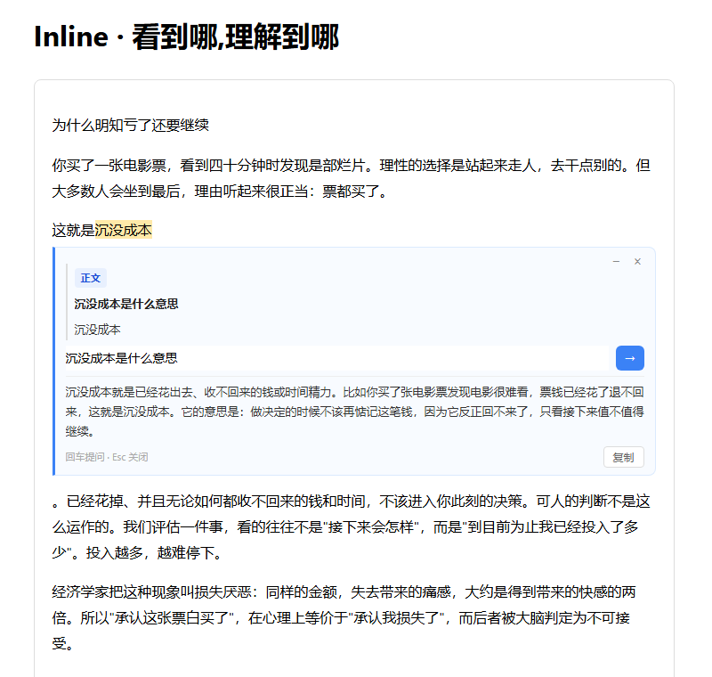
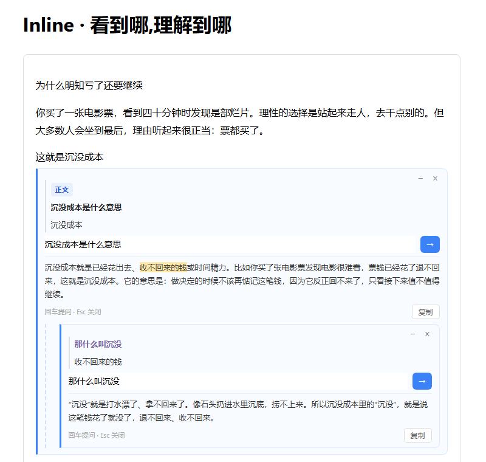
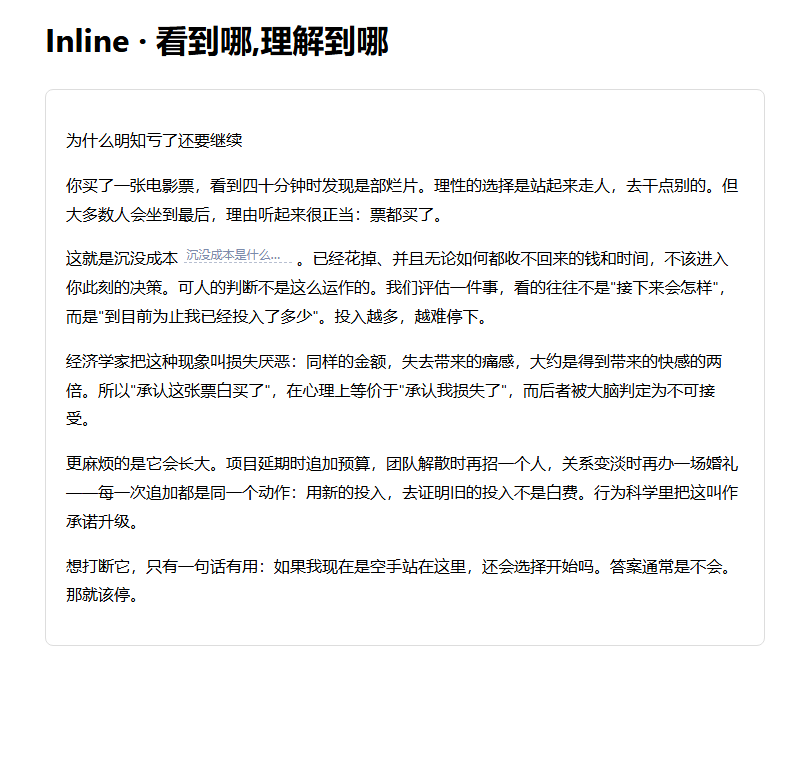

# Inline · Understand where you read

<p align="center">
  <picture>
    <source media="(prefers-color-scheme: dark)" srcset="assets/logo-dark.svg">
    
  </picture>
</p>

<p align="center"><sub><a href="README.md">中文</a> · <b>English</b></sub></p>

> **The answer should grow where the question is — not somewhere else.**

A single-file reading tool. Select text, a Q&A panel opens right there. Follow-ups stack into a chain. When you're done, collapse them: the article is an article again, with a few faint underlined notes left behind.

One `Inline.html`. No dependencies. Open it and read.

<p align="center">
  <a href="https://github.com/itzsu123/Inline/releases/latest/download/Inline.html">
    
  </a>
</p>

<p align="center"><sub>One file, no dependencies. Download it and open it in a browser</sub></p>

<p align="center"><sub>On a phone, don't download it — just open <a href="https://itzsu123.github.io/Inline/Inline.html">this link</a></sub></p>

<p align="center"><sub>Needs a DeepSeek API key — enter it once; it stays in your browser</sub></p>

<p align="center">
  
</p>

<p align="center"><sub>Select a word: the answer lands under that sentence — not beside it, not in a floating window.</sub></p>

<p align="center">
  
</p>

<p align="center"><sub>Select a phrase inside an answer and the follow-up nests one level deeper.</sub></p>

<p align="center">
  
</p>

<p align="center"><sub>Collapse it and the article is an article again — one faint dotted line left behind.</sub></p>

---

## What it's for

When you want to ask something mid-read, you have two options today:

- **Leave and search.** You come back and have to find the sentence again. Attention dropped once.
- **Open a sidebar or a floating panel.** The answer lives in a different plane, and you keep looking back and forth between two places.

Both ask you to do the same thing: **carry your attention away from the text, then carry it back.**

Inline makes a simpler assumption: the answer belongs wherever your attention already is.

## Where your data lives

**In your browser, and nowhere else.**

- Article and every panel are stored in `localStorage`. Refresh and they're still there.
- Your API key lives in `localStorage` too. Requests go straight from the browser to the API; there is no server in between.
- **Export** writes the whole article plus its Q&A to Markdown.
- **Backup / Import** moves everything to another browser via JSON.

No account, no backend, no analytics.

## Swapping the model

The model isn't hardcoded in the logic. There are two constants at the top of the file:

```js
const API_BASE  = "https://api.deepseek.com";
const API_MODEL = "deepseek-chat";
```

**Any service exposing an OpenAI-compatible `/chat/completions` endpoint works.** For example:

| Service | API_BASE | API_MODEL |
|---|---|---|
| DeepSeek (default) | `https://api.deepseek.com` | `deepseek-chat` |
| Qwen (DashScope) | `https://dashscope.aliyuncs.com/compatible-mode/v1` | `qwen-plus` |
| Kimi (Moonshot) | `https://api.moonshot.cn/v1` | `moonshot-v1-8k` |
| Local ollama | `http://localhost:11434/v1` | `qwen2.5:7b` ¹ |

¹ **Local ollama must allow the browser first**, otherwise the request is blocked by CORS (you'll see `Failed to fetch`, which looks like a network problem):

```bash
# macOS / Linux
OLLAMA_ORIGINS=* ollama serve

# Windows
set OLLAMA_ORIGINS=*
ollama serve
```

`*` lets any web page call your local model. Fine for personal use; shut it down afterwards.

After switching, the key field should hold **that provider's** key.

Two known edges:

- Only the plain `chat/completions` is used — no provider-specific parameters.
- A wrong model name is surfaced verbatim from the server inside the panel (with a retry).

## What this deliberately doesn't do

No accounts. No cloud sync. No history. No mobile app. No backend.

No PDFs either — this is inline Q&A, and there are far cleverer ways to go about it.

## License

MIT
